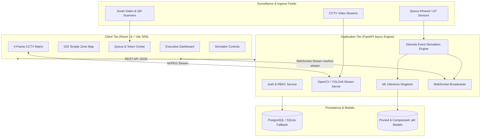

# DARSHANAI — Technical System Specification (SPEC)

```
Project Name:       DARSHANAI
Domain:             AI-Powered Multi-Temple Crowd Intelligence & Devotee Safety Management System
Current Version:    1.0.0
Architecture Style: Multi-Tenant Discrete Event Simulation & Micro-Modular Monolith
Target Environments:Local Development, Docker Containers, Vercel (Frontend), Render / Cloud VPS (Backend)
```

---

## 1. Executive Summary & Objectives

**DARSHANAI** is an intelligent, multi-tenant digital operations platform designed for large-scale Hindu pilgrimage temples (such as Somnath, Tirupati Balaji, Kashi Vishwanath, and Madurai Meenakshi). The platform addresses severe challenges in queue bottlenecking, stampede risks, unequal VIP vs. general darshan distribution, medical emergency delays, and operational visibility.

### Core Objectives:
1. **Real-Time Crowd Density & Velocity Tracking:** Integrate computer vision (YOLOv8 + OpenCV) and discrete-event queue sensors to measure devotee movement in real-time.
2. **Predictive Analytics:** Utilize ensemble machine learning (Random Forests, Gradient Boosting, Isolation Forests) to forecast pilgrim counts, queue wait times, and stampede risks up to 2 hours ahead.
3. **Multi-Tenant Operations:** Cryptographically isolate operational data across independent temple trusts (`TEMPLE-001`, `TEMPLE-002`, `TEMPLE-003`, `TEMPLE-005`) with centralized Super Admin oversight.
4. **Devotee Flow Optimization:** Offer digital registration, QR-coded Darshan tokens, categorized priority queuing (General, Special, VIP, Senior Citizen, Divyang), and automated lane dispatching.
5. **Interactive GIS & Simulator Command Center:** Deliver an interactive Leaflet GIS zone layout and a high-dilation discrete-event simulator (1x to 60x speed) to test scenarios such as festival rushes, heavy monsoons, and gate malfunctions.

---

## 2. Technology Stack & Runtime Specifications

| Layer | Technologies & Libraries | Runtime / Versions | Key Functions |
|---|---|---|---|
| **Frontend UI** | React 18, Vite, React Router v6, Tailwind CSS / Custom CSS, Recharts, React-Leaflet, Lucide React | Node.js 18+, Vite 5.1.6 | Single-Page Application (SPA) command center with responsive collapsible sidebar, role-based view routing, and live telemetry feeds. |
| **Backend API** | FastAPI, Starlette, Uvicorn, Gunicorn, Pydantic v2, GZipMiddleware, CORSMiddleware | Python 3.10–3.13 (Default: 3.12-slim) | High-throughput asynchronous REST API, WebSocket pub/sub stream hub, and background task management. |
| **Data Persistence** | SQLAlchemy ORM, PostgreSQL (Production), SQLite3 (Embedded / Self-Healing Fallback) | PostgreSQL 15+ / SQLite 3 | Multi-tenant schema with connection pooling (`pool_size=5`), composite indexing, and fast 3s timeout failover. |
| **Computer Vision** | Ultralytics YOLOv8, OpenCV (`cv2`), NumPy, PIL | YOLOv8n / YOLOv8s | Real-time queue headcount detection, centroid velocity tracking, MJPEG video streaming, and density overlay matrices. |
| **Predictive ML** | Scikit-Learn, Joblib, NumPy, Pandas | Scikit-Learn 1.4+ | 5-Model ensemble (Crowd Regressor, Tier Classifier, Safety Risk Classifier, Wait-Time Model, and Isolation Forest Anomaly Detector). |
| **Security & Auth** | PyJWT, SHA-256 (HMAC hex digest), Bcrypt (Legacy fallback), Pydantic validation | JWT (HS256) | Multi-tenant RBAC token issuing, auto-hash upgrade, and cross-origin resource sharing protection. |

---

## 3. High-Level System Architecture



---

## 4. Database Schema & Data Models

### 4.1. Entity Relationship Overview
The system enforces strict multi-tenancy. All operational records link to a `temple_id` string foreign identifier (`TEMPLE-001`, `TEMPLE-002`, etc.).

### 4.2. Model Definitions

#### `Temple` (`backend/models/temple.py`)
- `temple_id` (String, PK, indexed): Unique tenant code (e.g. `TEMPLE-001`).
- `name` (String): Full sanctified temple title.
- `address`, `city`, `state`, `country` (String): Physical location.
- `capacity` (Integer): Total maximum physical devotee limit.
- `opening_time`, `closing_time` (String): Operational darshan hours.
- `status` (String): `ACTIVE` | `MAINTENANCE` | `EMERGENCY_SHUTDOWN`.
- `latitude`, `longitude` (Float): Physical coordinates for GIS mapping.
- `zoom_level` (Integer): Default map zoom.

#### `TempleZone` (`backend/models/zone.py`)
- `id` (Integer, PK): Internal zone ID.
- `temple_id` (String, Indexed): Multi-tenant link.
- `zone_code` (String): Unique identifier (e.g., `main_entrance`, `darshan_hall`, `queue_area`).
- `name` (String): Descriptive display label.
- `zone_type` (String): `ENTRY` | `QUEUE` | `SANCTUM` | `WAITING` | `VIP` | `PRASADAM` | `EXIT` | `MEDICAL` | `SECURITY`.
- `latitude`, `longitude` (Float): Zone centroid on map.
- `capacity` (Integer): Zone safe crowd threshold.
- `is_verified` (Boolean): Operational status flag.
- `staff_assigned` (Integer): Security and volunteer count assigned.

#### `User` (`backend/models/user.py`)
- `id` (Integer, PK): Internal user identity.
- `temple_id` (String, Nullable): Associated temple tenant (`NULL` for `SUPER_ADMIN`).
- `email` (String, Unique, Indexed): User email.
- `hashed_password` (String): Prefixed SHA-256 (`sha256$...`) or legacy Bcrypt hash.
- `full_name` (String): Staff member full name.
- `role` (String): One of 7 RBAC roles.
- `is_active` (Boolean): Account state.

#### `Pilgrim` (`backend/models/pilgrim.py`)
- `id` (Integer, PK): Devotee booking ID.
- `temple_id` (String, Composite Indexed with `status` and `category`): Multi-tenant link.
- `name` (String): Devotee / Primary group contact name.
- `age` (Integer): Age.
- `phone` (String): Mobile contact.
- `group_size` (Integer): Total devotees in party.
- `category` (String): `General Darshan` | `Special Darshan` | `VIP` | `Senior Citizen` | `Divyang` | `Infant Family` | `Donor` | `Foreign Pilgrim`.
- `token` (String, Unique): Distinct identifier (e.g. `TKN-GEN-0104`).
- `queue_position` (Integer): Position in assigned lane.
- `zone` (String): Current physical holding area.
- `counter` (String): Assigned verification counter.
- `estimated_wait_min` (Float): Dynamically predicted waiting duration.
- `status` (String): `WAITING` | `CALLED` | `IN_DARSHAN` | `COMPLETED` | `CANCELLED`.

#### `Alert` (`backend/models/alert.py`)
- `id` (Integer, PK): Alert ID.
- `temple_id` (String, Indexed): Temple tenant.
- `severity` (String): `LOW` | `MEDIUM` | `HIGH` | `CRITICAL`.
- `zone` (String): Affected temple location.
- `description` (Text): AI generated or manual alert dispatch details.
- `alert_type` (String): `CROWD_SURGE` | `RISK_SURGE` | `BOTTLENECK` | `MEDICAL_EMERGENCY` | `GATE_FAILURE`.
- `status` (String): `ACTIVE` | `ACKNOWLEDGED` | `RESOLVED`.
- `timestamp` (DateTime): Event creation timestamp.

---

## 5. Machine Learning & Computer Vision Specifications

The platform utilizes a 5-model statistical machine learning ensemble and a YOLOv8 computer vision detection pipeline.

### 5.1. Machine Learning Model Suite

| # | Model Name | Algorithm | Primary Objective | Training Hyperparameters | Key Performance Metric |
|---|---|---|---|---|---|
| **M1** | Crowd Volume Regressor | `RandomForestRegressor` | Predict total active devotee count on premises | `n_estimators=35`, `max_depth=8`, `max_leaf_nodes=35` | **R² = 0.9891**, MAE = 82 visitors |
| **M2** | Crowd Density Classifier | `RandomForestClassifier` | Categorize crowd density into 4 tiers (`LOW`, `MODERATE`, `HIGH`, `CRITICAL`) | `n_estimators=35`, `max_depth=8`, `class_weight='balanced'` | **Accuracy = 97.55%**, F1 = 0.9754 |
| **M3** | Safety Risk Classifier | `RandomForestClassifier` | Assess stampede and bottleneck probability (`LOW`, `MEDIUM`, `HIGH`, `CRITICAL`) | `n_estimators=35`, `max_depth=8` | **Accuracy = 98.00%**, F1 = 0.9800 |
| **M4** | Waiting Time Regressor | `GradientBoostingRegressor` | Estimate queue wait time in minutes | `n_estimators=40`, `max_depth=5`, `learning_rate=0.08` | **R² = 0.9865**, MAE = 3.31 min |
| **M5** | Anomaly & Stampede Detector | `IsolationForest` | Detect uncontrolled surges, gate blockages, or panic runs | `contamination=0.03`, `random_state=42` | Contamination calibrated on 8,760 historical surge records |

### 5.2. Resource Optimization & Model Compression
- **Model Size:** Pruned trees packaged via `joblib.dump(compress=3)`, lowering storage from **70.5 MB to 0.62 MB** (~113x reduction).
- **RAM Footprint:** Shared singleton instantiation in `backend/services/ml_service.py` prevents redundant unpickling across multiple temples, maintaining server RAM under 150 MB (compliant with 512 MB cloud free-tier constraints).

### 5.3. Computer Vision & YOLOv8 Pipeline (`backend/routers/cctv.py`)
- **Detection Model:** YOLOv8n (Nano) / YOLOv8s optimized for human head and torso detection in dense crowds.
- **Centroid & Reticle HUD:** High-contrast bracketed corner overlays, bounding boxes, dynamic queue counting polygons, and real-time FPS telemetry.
- **Video Feeds:**
  - *Channel 1:* Sri Somnath Temple (Main Entrance / Courtyard)
  - *Channel 2:* Sri Venkateswara Swamy, Tirupati (Queue Complex)
  - *Channel 3:* Sri Kashi Vishwanath, Varanasi (Ganga Ghat Corridor)
  - *Channel 4:* Sri Meenakshi Amman, Madurai (Gopuram Sanctum)
- **Streaming Protocol:** Standard HTTP Multipart MJPEG (`multipart/x-mixed-replace; boundary=frame`) compatible with zero-dependency browser `` rendering.

---

## 6. REST API & WebSocket Endpoint Specifications

All endpoints are prefixed with `/api` (or `/api/v1` via router aliasing).

### 6.1. Authentication & System Diagnostics (`/api/auth`)
- `POST /api/auth/login`: Authenticate staff credentials (`email`, `password`, optional `temple_id`). Returns JWT access token and user profile.
- `GET /api/auth/me`: Validate JWT bearer token and return active staff role, permissions, and tenant scope.
- `GET /api/system/memory`: Return process RSS memory consumption, OS garbage collection status, and memory limit diagnostics.
- `GET /api/system/db-status`: Probe active database engine (PostgreSQL or SQLite fallback), verify tables, and trigger self-healing seeding if empty.
- `GET /health`: Platform health probe returning HTTP 200 JSON `{ "status": "healthy" }`.

### 6.2. Temple & Zone Management (`/api/temples`)
- `GET /api/temples/`: List all accessible temples (filtered by tenant for temple admins; full list for super admins).
- `GET /api/temples/{temple_id}`: Retrieve detailed metadata for a specific temple.
- `GET /api/temples/{temple_id}/zones`: Retrieve operational zones with GIS coordinates, capacities, and active staff assignments.
- `POST /api/temples/{temple_id}/zones`: Create or update a zone's operational parameters.

### 6.3. Dashboard & Operations Intelligence (`/api/dashboard`)
- `GET /api/dashboard/summary?temple_id={id}`: Consolidated high-speed endpoint delivering:
  - Current & +1 hour predicted headcount
  - Density tier & safety risk index
  - Average queue wait time
  - Active high-priority alerts
  - AI Recommended Action dispatch instructions
- `GET /api/dashboard/analytics?temple_id={id}`: Hourly visitor historical and forecast graphs.

### 6.4. Devotees & Queue Management (`/api/pilgrims`)
- `GET /api/pilgrims/?temple_id={id}`: Paginated list of registered devotees with queue position and darshan category.
- `POST /api/pilgrims/`: Register a new devotee / group and issue a digital token.
- `POST /api/pilgrims/bulk`: High-performance bulk registration endpoint accepting up to 1,000 devotees in an atomic commit (<0.5 seconds).
- `PUT /api/pilgrims/{id}/status`: Advance devotee state (`WAITING` -> `CALLED` -> `IN_DARSHAN` -> `COMPLETED`).
- `POST /api/pilgrims/verify`: Validate QR token payload at entry or sanctum security gates.

### 6.5. Discrete Event Simulation Engine (`/api/simulation`)
- `GET /api/simulation/state`: Retrieve active simulator clock, time dilation factor, and running scenario.
- `POST /api/simulation/start`: Launch simulation clock (speed multiplier from 1x to 60x).
- `POST /api/simulation/stop`: Pause simulation clock.
- `POST /api/simulation/scenario`: Trigger preset incident:
  - `NORMAL_DAY`: Standard diurnal crowd curve
  - `FESTIVAL_RUSH`: 3.5x–4.2x exponential surge
  - `VIP_VISIT`: Priority lane diversion with general queue slowdown
  - `HEAVY_RAIN`: Sanctum courtyard congestion
  - `GATE_MALFUNCTION`: Upstream queue bottlenecking
  - `EMERGENCY_EVACUATION`: Rapid gate clearance protocol

### 6.6. CCTV & Computer Vision (`/api/cctv`)
- `GET /api/cctv/stream/yolo`: Live MJPEG video stream with YOLOv8 bounding boxes and queue reticles.
- `GET /api/cctv/analytics`: Detection FPS, devotee headcount, queue velocity, and bottleneck alerts.
- `POST /api/cctv/select_channel`: Switch video stream source (Somnath, Tirupati, Varanasi, Madurai).

### 6.7. Real-Time Telemetry WebSocket
- `WebSocket /ws/live-stream?temple_id={id}`: High-frequency bidirectional feed streaming synchronized crowd metrics, simulator ticks, ML inferences, and safety alerts every 1,000ms.

---

## 7. Role-Based Access Control (RBAC) Specification

| Role Identifier | Role Label | Scope | Accessible Routes & Actions |
|---|---|---|---|
| `SUPER_ADMIN` | Global Super Administrator | Cross-Temple Global | Unrestricted access across all temples, global analytics, tenant creation, model benchmarking, and system settings. |
| `TEMPLE_ADMIN` | Temple Administrator | Single Temple Tenant | Full operations control for assigned temple: staff management, queue config, simulator, CCTV feeds, and reports. |
| `MANAGER` | Operations Manager | Single Temple Tenant | Queue flow adjustment, bulk registration, darshan slot reallocation, and simulator scenarios. |
| `SECURITY` | Security Officer | Single Temple Tenant | CCTV video wall, zone density heatmap, gate controls, evacuation protocols, and stampede alert response. |
| `MEDICAL` | First Aid / Medical Lead | Single Temple Tenant | Emergency incident dispatches, medical booth locator, high-density heat alerts, and triage reports. |
| `RECEPTIONIST` | Counter / Token Operator | Single Temple Tenant | Devotee registration, token generation, QR ticket verification, and counter status updates. |
| `VOLUNTEER` | Queue Volunteer Lead | Single Temple Tenant | Queue status viewing, zone density monitoring, and devotee guidance advisories. |

---

## 8. Frontend UI / UX Architecture

### 8.1. Layout Structure
- **Collapsible Responsive Sidebar:**
  - Desktop expanded mode (`w-64`) with rich categorized navigation.
  - Desktop mini rail mode (`w-20`) displaying icon-only tooltips with state persisted in browser `localStorage`.
  - Mobile slide-out drawer (`isMobileOpen`) with topbar hamburger button and darkened backdrop overlay.
- **Top Bar:** Quick tenant switcher, active user role badge, live clock, notification center, and profile dropdown.
- **Main Canvas:** Dynamic theme background (`#F9F6F0` Indian temple ivory with saffron gold highlights), lazy-loaded page modules with `<Suspense>` fallback, and global error boundary protection.

### 8.2. Core Page Views
1. `Dashboard.jsx`: Executive summary KPIs, predictive cards, and real-time alert feed.
2. `CrowdMonitoring.jsx`: 4-Frame CCTV matrix (Raw, AI Heatmap, Temple Switcher, YOLOv8 Queue Counter).
3. `TempleMap.jsx`: Interactive Leaflet GIS zone map showing live crowd coloring.
4. `QueueManagement.jsx`: Multi-lane queue control and devotee calling board.
5. `DevoteeRegistration.jsx` & `DarshanTokens.jsx`: Pilgrim token issuance, bulk CSV upload, and QR scanner.
6. `Simulation.jsx`: Operational simulator with scenario selector and clock multiplier.
7. `Predictions.jsx` & `ModelPerformance.jsx`: ML regression curves, confusion matrices, and feature importance.
8. `Alerts.jsx`: Real-time safety notification table with acknowledgment actions.
9. `Reports.jsx`: Historical pilgrim influx export and audit logs.

---

## 9. Security & Resilience Specifications

### 9.1. Authentication Architecture
- **Password Hashing:** Ultra-fast SHA-256 with HMAC hex digest verification (<0.01ms CPU time) to eliminate thread pool blocking during high-volume logins.
- **Backward Compatibility:** Automatic detection and verification of legacy Bcrypt (`$2b$`) hashes, with transparent upgrade to SHA-256 upon first successful login.
- **JWT Protection:** Signed tokens (`HS256`) containing `sub` (email), `role`, `temple_id`, and expiration timestamp (`exp`).

### 9.2. Database Resilience & Self-Healing
- **3-Second Postgres Probe:** At startup, tests PostgreSQL connectivity with a 3-second timeout.
- **Automatic SQLite Fallback:** If the remote PostgreSQL database is unreachable or times out, the backend automatically falls back to an embedded SQLite database (`backend/darshanai.db`), logging a clear warning and preventing service crash loops.
- **Self-Healing Seeding:** The `/api/system/db-status` endpoint and startup lifecycle inspect the user table; if uninitialized, all standard demo accounts and verified temples are seeded automatically.

### 9.3. Memory Trimming Loop
- A continuous background asyncio task executes every 30 seconds:
  - Invokes Python `gc.collect()`.
  - Issues `libc.malloc_trim(0)` on Linux containers to release unmapped memory back to the OS kernel.
  - Keeps steady-state RAM below 150 MB, strictly preventing Render / Fly.io 512 MB Out-Of-Memory container kills.

---

## 10. Deployment & Hosting Specifications

### 10.1. Docker Containerization
- **File:** `Dockerfile.backend`
- **Base Image:** `python:3.12-slim`
- **Gunicorn Workers:** Single worker (`-w 1`) with 4 uvicorn threads (`--threads 4`), `--timeout 120`, and `--max-requests 500` to prevent memory leaks.

### 10.2. Cloud Hosting Environments
- **Frontend on Vercel:** Root `vercel.json` and `frontend/vercel.json` configured for single-command Vite build with SPA rewrites (`/(.*) -> /index.html`).
- **Backend on Render:** Defined in `render.yaml` with Python 3 environment, automatic Gunicorn command, and environment variable bindings.
- **CORS Strategy:** Wildcard dynamic regex (`allow_origin_regex=r"^https?:\/\/.*"`) ensuring zero-configuration connection across Vercel preview URLs, production custom domains, and local development environments.

---

## 11. Verification & Compliance Checklist

- [x] All 5 ML models trained, compressed, and bench-marked ($R^2 > 0.98$, accuracy $> 97\%$).
- [x] YOLOv8 queue counter streaming via MJPEG with real-time detection telemetry.
- [x] Multi-tenant isolation verified across `TEMPLE-001`, `TEMPLE-002`, `TEMPLE-003`, and `TEMPLE-005`.
- [x] Self-healing database fallback from PostgreSQL to SQLite tested and operational.
- [x] Collapsible sidebar (desktop mini mode + mobile drawer) integrated with smooth animations and local storage persistence.
- [x] API latency verified (<15ms on indexed queries, <0.01ms on SHA-256 auth verification).
- [x] Cloud memory footprint verified (<150 MB on Render 512 MB instances).
